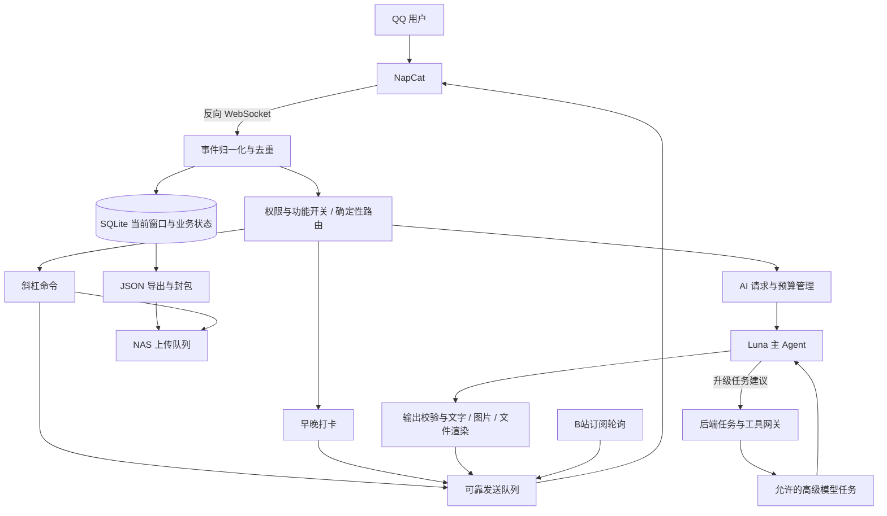

# QQ 机器人功能设计与开发方案 v0.1

> 实施状态更新（2026-10-16）：基础、打卡、多模型 AI、图片渲染、NAS 自身归档和直播订阅已实现。下文保留方案初稿；当前行为和验收请以 [开发进度](development-status-2026-10-16.md) 为准。Agent 按用户最新选择使用本机 full_access；用户 NAS 保存及B站动态暂缓，上线部署不执行。

日期：2026-10-15（Asia/Shanghai）。状态：供审核的完整方案初版，含已确认决策与待定参数；不是功能开发完成声明。

## 1. 目标、依据与已确认决策

依据用户提供的《需求草案.md》及本轮问答、项目源码、指定 QQ 目标的真实收发测试。原始草案保留在原位置，不复制其中的密码。

| 事项 | 当前决策 |
| --- | --- |
| 基础框架 | 继续使用 NapCat + OneBot v11 + NoneBot2/Python |
| 存储 | SQLite 保存当前消息窗口及业务状态，超出窗口的旧消息导出 JSON 归档 |
| AI 认证 | 使用 ChatGPT 订阅登录，通过官方 `openai-codex` Python SDK |
| 主模型 | `gpt-6-luna`；高级模型由后端允许列表控制 |
| 调度 | Luna 提出高级任务，后端校验后创建任务，结果由主 Agent 整合 |
| 角色继承 | `superuser > admin > vip > user`；admin 自动享有 VIP 无限 AI 业务额度 |
| superuser | 唯一 QQ `2430023288`，不可被普通运行时角色命令替换 |
| 私聊上下文 | 按用户持续；`/new`、`/新会话`创建新会话 |
| 群聊上下文 | 默认本条消息与引用；`/context`、`/上下文`显式带入限量历史；群历史只可在原群使用 |
| 命令别名 | 面向普通用户的常用命令提供中文别名；管理命令以英文为主 |
| 晚安日期 | 00:00—03:00 归前一天 |
| 连续次数 | 每次有效打卡累计；具体“中断”口径见第 8 节待确认说明 |
| NAS 目录 | 以对应账号的个人文件夹为逻辑根目录组织文件 |
| NAS 地址/协议 | 更正为 `192.168.124.3:22`，SFTP 登录与 `/home` 微型文件往返已通过 |
| NAS 路径映射 | 用户在个人文件夹创建的空目录已在 `/home` 找到，映射核实，测试空目录已删除 |
| 普通用户 AI 额度 | 默认 20 次/日；admin/superuser 可改；顶层成功扣 1，高级任务不额外扣，提供方失败不扣，生成开始后取消扣 1 |
| 测试目标 | 群 `1049251004`、私聊大号 `2430023288`；机器人 QQ `3653125828` |

当前生产入口仍只有基础命令。新增的 `tools/feasibility/` 是独立验证脚本，不默认加载为机器人插件。测试原始数据与依赖均放在被 Git 忽略的 `artifacts/`。

## 2. 系统边界与模块划分



推荐单机、单业务进程起步：NoneBot/FastAPI 负责事件、业务服务与轻量后台任务；SDK 使用 `AsyncCodex`，避免同步推理阻塞事件循环。图片渲染和阻塞文件协议放入独立工作进程或受限线程。初期不引入 Redis、Celery 或微服务；存在多实例需求时再升级协调与数据库。

代码建议：

```text
bot/
  plugins/          # 命令注册、规则与事件入口，保持薄层
  domain/           # 消息、权限、配额、打卡、订阅等业务模型
  services/         # MessageService、PolicyService、CheckinService 等
  repositories/     # SQLite 访问、迁移、事务
  ai/               # SDK provider、上下文、任务编排、输出协议
  media/            # 下载、类型检测、文本抽取、渲染、生命周期
  integrations/     # NapCat 扩展 API、NAS、B站 provider
  workers/          # 归档、上传、轮询、发送队列
  config/           # 配置模型、校验、热更新
```

上述为计划目录，不代表已经创建了完整实现。

## 3. 消息入口、支持范围与路由

### 3.1 接收与响应是两个独立判断

NapCat 可以上报机器人所在群的事件。业务层只长期记录私聊及配置中指定的群；未监听群不参与 AI、打卡或普通命令响应，但允许有权限者执行添加监听的管理命令。

顺序建议：验证上报来源 → 忽略自身循环消息 → 事件标识去重 → 归一化及允许范围内落库 → 封禁/总开关 → 命令 → 打卡严格匹配 → AI 触发。所有出站动作还须在发送前复查开关和目标。

- 群内 `/` 命令无需 @；实际 `/ping` 已验证。
- 群内普通文字的 AI 触发检查原始 `at` 段是否指向机器人。at 的检查可以用 `to_me()`。
- 私聊默认 AI 开，群聊默认关；群监听与群 AI 开关分别存储。
- 未知 `/xxx` 提供命令提示，不直接交给 AI；`/ask` 可强制把后面的文本作为 AI 请求。
- 打卡从纯文本整条消息严格匹配；包含图片、引用、@、额外标点的消息不按普通打卡处理。是否允许去掉首尾空格待审核。
- 记录原文、用于命令解析的文本分别保存；保留昵称快照与群名片快照。

### 3.2 消息规范

建议统一结构包含：`schema_version`、`bot_id`、`conversation_id`、`event_key`、`message_id`、`message_seq`、`direction`、`sender_id`、昵称/群名片、UTC 时间、接收时间、有序 `segments`、`reply_to`、撤回状态。

会话键：`private:{bot_id}:{user_id}`、`group:{bot_id}:{group_id}`。QQ 号等标识对外 JSON 统一使用字符串；数据库约束使用 `(bot_id, conversation_id, message_id)` 并辅以协议序号。通知事件另设稳定标识，不能以所有空 `message_id` 共用一个去重键。

本机适配器会移除用于处理的 `@`、`reply` 段，将引用内容置于 `event.reply`。归档应使用 `original_message` 的有序段、引用快照和协议标识，不能只保存 `get_plaintext()`。当前测试捕获是适配器解析后的事件，若需逐字节协议审计，应另加进入适配器前的采集层。

| 类型 | MVP 行为 | 后续边界 |
| --- | --- | --- |
| 文本、@、QQ 表情 | 保存有序消息段；表情保留 ID，提供文本占位 | 不将表情占位误当成自然语言指令 |
| 图片、图文混排 | 保留段序；仅在 AI/保存请求确需时下载 | GIF 可取首帧并声明；不默认分析动画全部帧 |
| 表情包 | 按实际 image/子类型保存元信息 | 有图片实体才按图像分析，不假定等于 QQ face |
| 私聊/群文件 | 先记录标识；显式请求后获取文件 | 类型与大小限制，拒绝自动执行 |
| 回复 | 关联原消息；最多一层引用默认进入请求 | 不无限递归展开；跨会话读取被拒绝 |
| 合并转发 | 保存标识与可得节点，显式请求时限量展开 | 必须限制层数、节点数、总字节及跨会话泄露 |
| JSON/小程序/音乐/分享卡片 | 保存原始载荷，安全解析标题及链接作为数据 | 不执行卡片代码，不自动访问任意 URL |
| 语音/视频 | MVP 记录元数据并提示暂不支持内容理解 | 转录、转码与视频采样作为单独扩展 |
| 群公告/入群/撤回/文件上传 | 作为通知事件独立处理 | 不是所有通知都具有可引用的消息 ID |
| 原生 Markdown | 不作为通用输出前提 | 文档描述的发送方式有协议限制，采用图片/文件兜底 |

NapCat 的收发类型、文件 URL 刷新与扩展 API 以对应版本文档为准：[消息兼容](https://napneko.github.io/develop/msg)、[文件处理](https://napneko.github.io/develop/file)。转发、卡片、语音和公告尚未逐项真实实测。

### 3.3 媒体按需下载

流程：收到消息只落元数据 → 确定会交给 AI 或保存 → 收集本条/有权限引用中的附件 → 尝试现有 URL → 失效时用协议文件标识刷新 → 限量下载 → MIME/文件头校验 → 分配 `artifact_id`。已实际验证引用后下载图片、群文件及私聊 `get_file`。

历史 URL 有时效，延迟下载可能失败；保存 `message_id` 和文件标识以支持刷新，彻底失效时要求重发。

下载采用流式计数、超时、重定向复检、DNS/IP 校验，拒绝回环、链路本地及非授权内网地址；NAS 本身只由专用连接器访问。文件名不参与本地路径拼接。

临时媒体使用引用计数与到期时间：任务结束且发送确认后释放；默认 24 小时清理可作初始值；重试/上传中的附件不得提前删除。文件持久化到 NAS 后以 NAS 清单为准；普通聊天图片不默认长期归档。过期媒体保留“实体已清理”的记录。

## 4. SQLite、JSON 归档与配置

### 4.1 数据表

| 表 | 核心约束与职责 |
| --- | --- |
| `users`、`user_roles` | QQ 身份、昵称、角色、封禁；superuser 来自受保护启动配置 |
| `conversations`、`conversation_settings` | 类型、群监听、AI/打卡开关、版本号 |
| `messages`、`message_segments` | 最近窗口与尚未批量导出的旧消息，原始段可存 JSON |
| `attachments` | 文件标识、所属会话、哈希、大小、缓存状态与到期时间 |
| `context_sessions` | 私聊用户或群内请求的 SDK thread 映射、重置代数 |
| `ai_requests`、`ai_tasks` | 请求去重、状态机、模型、耗时、失败原因、父子关系 |
| `quota_daily`、`quota_ledger` | 本地日期、已用/预留/临时加赠、结算及人工调整审计；每日上限以策略配置文件为准 |
| `checkins`、`checkin_collection` | 唯一 `(群, 用户, 业务日期, morning/night)`；文案收集 |
| `subscriptions`、`subscription_cursors` | 订阅、共享轮询状态、各群发送游标 |
| `archive_jobs`、`archive_manifest` | 冻结导出范围、哈希、位置、上传和清理状态 |
| `nas_bindings`、`transfer_jobs` | QQ/NAS 绑定、凭据引用、传输状态及幂等键 |
| `outbox`、`audit_log` | 可靠发送、人工可查的敏感操作轨迹 |

数据库只放在机器人本地磁盘。使用 WAL、外键、短事务、忙等待及迁移版本。备份使用 SQLite 备份接口，避免只复制主文件而丢失 WAL。

### 4.2 当前窗口与滚动归档

建议每个会话维持最近 1000 条作为“当前窗口”，超出部分暂存待导出区；累计 1000 条旧消息形成一个紧凑、单行 JSON 数组。暂存区可以仍在 SQLite，避免每来一条消息重写两个 JSON 文件。1000 是存储窗口，不是每次喂给 AI 的数量。

每个归档批次拥有固定 ID、序号范围、条数、schema 版本及 SHA-256。流程：

1. 数据库事务冻结待导出范围并创建任务；同一会话仅一个导出任务。
2. 写 `.tmp`，刷新并校验，再以同文件系统重命名发布；读取侧只认已提交清单。
3. 数据库事务提交归档清单后，才能删除对应在线旧记录；失败重跑同一个批次。
4. 将已完成 JSON 批次封装成不可变 ZIP，避免不停修改同一个历史包。封包前预估压缩大小，超过阈值则封存上一个包；单个批次自身超过阈值时允许单独超限包并记录。
5. 达到 10 MB 建议按 `10,000,000` 字节解释；另加最大等待时间，建议 24 小时，避免小群数据永远不上传。二者待审核。
6. 上传 NAS 临时文件 → 验证字节数与哈希 → 改最终名 → 清单标记已验证 → 才可按保留策略清理本地封包。

归档任务与上传任务分开。NAS 故障时继续本地排队；触及本地磁盘低水位后暂停非必要下载/归档输入并告警，不能静默丢记录。最终删除策略、保留天数与加密尚待确定。归档恢复要验证 hash/schema，应用撤回或删除 tombstone，再按稳定标识幂等导入。

合成实验已验证“写前、重命名后、数据库提交前、提交后”四类中断点的恢复、3000 条消息无丢失无重复；这是最小协议验证，不覆盖断电、文件系统损坏、多进程导出或 NAS 上传。

### 4.3 配置分层与热更新

- `.env` / 系统凭据：OneBot Token、NAS 密码/私钥、加密主密钥；不进入 Git，不进入 AI 请求。
- `config.toml`：时区、路径、窗口、媒体限制、模型允许列表、默认参数；Python 3.11+ 可用 `tomllib` 读取。
- `config/policy.toml`：可管理的配额策略文件，保存每日默认上限 20 次及用户专属每日上限；admin/superuser 修改后原子写回并热更新。模板是 `config/policy.example.toml`，不自动加载为现有功能。
- SQLite：角色、群监听、功能开关、每日额度用量/预留/临时加赠和流水；每日上限不在两处维护。请求中可保存当时上限与策略版本快照用于审计。
- Skill：主 Agent 工作说明与输出约定，纳入代码审查及版本号；不能用 Skill 代替权限代码。

权限、群开关、额度、文案和默认模型可以热更新：校验 → 持久化 → 发布配置版本；新请求使用新版本，已在执行的请求默认保持原快照。封禁、总开关、撤销 NAS 绑定在出站/工具执行时实时复查。端口、驱动、依赖升级、迁移或凭据存储方式变更通常需要受控重启。

额度策略写文件采用单写锁、版本/原哈希比较、临时文件刷新与原子替换；SQLite 先记录 pending 配置变更，文件发布后补齐 applied 与审计，启动时按文件哈希核对未完成变更。降低上限不会扣回已完成请求或释放在途预留，剩余额度至少为 0，后续请求按新策略准入。当天临时加赠与长期上限修改分开。

## 5. 权限与命令设计

QQ 群主/群管理员身份与 bot 全局角色分开，群主不会自动成为 bot admin。用户身份只取自可信 OneBot 事件，不能从文本、引用者身份或 AI 输出推断。

| 规范命令与别名 | 最低角色 | 语义与限制 |
| --- | --- | --- |
| `/help`、`/帮助` | user | 按当前权限与会话显示可用命令 |
| `/ping` | user | 在线检查；不用生成 AI 请求 |
| `/status`、`/状态` | user | 仅公开运行状态与本会话状态，不泄露配置/密钥 |
| `/echo`、`/复读` | user | 只回复纯文本，长度和频率受限 |
| `/ask`、`/提问` | user | 显式 AI 请求，仍受群 AI 开关与额度约束 |
| `/new`、`/新会话` | user | 重置自己的私聊上下文；原任务响应不得污染新会话 |
| `/context`、`/上下文` | user | 群内显式指定 `user N` 或 `group N`；默认只影响下一次请求 |
| `/quota`、`/额度` | user | 查看自己的业务额度及重置时间 |
| `/checkin-get`、`/打卡查询` | user | 查询本群累计、连续统计与文案收集 |
| `/save`、`/保存` | user | 引用文件保存到自己的已绑定 NAS 目录 |
| `/nas bind/status/unbind`、`/网盘 绑定/状态/解绑` | user | 绑定在私聊进行；群内仅提示转私聊 |
| `/cancel`、`/取消` | user | 取消自己的排队/执行任务，按实际阶段结算 |
| `/subscriptions`、`/订阅列表` | user | 查看本群订阅，敏感配置隐藏 |
| `/experimental ...` | vip | 实验功能；不绕过硬性权限与资源限制 |
| `/watch add <群号>` | admin | 添加已加入群监听；首次操作需要明确群目标 |
| `/ai on/off` | admin | 设置本群 AI 开关 |
| `/checkin on/off` | admin | 本群打卡开关 |
| `/quota-admin limit default <N>`、`limit user <QQ> <N>` | admin | 修改策略配置文件中的默认/个人每日上限；对后续请求热生效 |
| `/quota-admin grant/reset (QQ)` | admin | 临时加赠/重置 user 当日用量；QQ号非必填，不填则是全部重置 |
| `/subscribe bili-live/bili-dynamic ...`、`/unsubscribe ...` | vip | 本群订阅修改；普通用户修改权限待审核 |
| `/admin add/remove <QQ>` | superuser | 维护 admin，不得改动唯一 superuser |
| `/vip add/remove <QQ>` | superuser | 授予 VIP；具体授权层级待审核 |
| `/ban <QQ>、/unban <QQ>` | superuser | 禁止该用户业务交互，不能影响恢复控制台 |
| `/watch remove <群号>` | superuser | 取消监听，后续停止采集和发送 |
| `/model set <allowed-model>` | superuser | 校验允许列表与可用性，再更新后续请求默认模型 |
| `/high-model set <allowed-model>` | superuser | 更新默认采用的高级模型 |
| `/bot off/on` | superuser | off 停止对其他用户响应及主动通知；保留本人恢复入口 |
| `/system health/reload` | admin | 受限诊断/热更新，不执行任意 shell |
| `/system restart` | superuser | 仅固定服务重启、任务排空及状态落盘 |

这是拟定命令目录，除项目现有四条基础命令外尚未实现。中文和英文别名注册到同一个命令处理器、权限检查和审计入口，不能复制两套逻辑。

总开关关闭后继续记录聊天。重启应由固定的服务控制器完成，不能提供 `/shell <任意命令>`。

## 6. AI 请求、模型编排与安全

### 6.1 SDK 认证和本次实测结论

官方 Python SDK 通过本地 app-server 通信，发布包有固定版本的 CLI 依赖。本机隔离环境安装 `openai-codex==0.162.1`，正常读取现有登录后，`gpt-6-luna` 请求成功。[Codex SDK](https://learn.chatgpt.com/docs/codex-sdk)

本机 CLI 报告 ChatGPT 登录；图片、JSON 输出、同 thread 连续上下文与下一轮改用 `gpt-6.1-sol` 均通过小测试。[认证文档](https://learn.chatgpt.com/docs/auth)

### 6.2 后端状态机

`received → authorized → quota_reserved → queued → preparing_media → running_main → [running_advanced] → formatting → sending → succeeded`。

失败/取消进入 `failed` 或 `cancelled`；恢复时不要自动重发所有 `running` 推理请求。重连后先核对 SDK thread/turn 状态，无法确定是否已执行时标为待确认。每个请求有 `request_id` 与幂等键，发出消息、扣费、NAS 上传各有独立状态。

每个用户/上下文同一时刻仅一个推理任务，超出进入有界队列；建议全局初始并发 2，单任务 120 秒软超时，排队超时单独计算。超时应发送 SDK 中断并清理子任务，不能只让 Python `wait_for` 超时后留下后台推理。取消、全局开关和服务退出均须覆盖子任务。以上限制待压测调整。

已确认额度规则：普通用户默认每日 20 次，成功完成的顶层请求扣 1 次，高级任务不另扣。先预留，排队拒绝/提供方失败释放，同一请求重试不重复扣；尚未开始生成时取消不扣，生成开始后用户取消扣 1 次。admin/superuser 可通过命令修改策略配置文件中的每日默认/个人上限。另设 token、耗时、高级任务次数和每日全局成本硬上限，避免无限业务额度变成无限资源。

“生成开始”建议以主 Agent `turn/started` 为可观察边界；若随后提供方报错则按失败释放。模型成功但 QQ 发不出去时建议保留结果待发送，不再次调用模型、不再次扣次；按模型生成成功结算还是按 QQ 送达结算仍须在实施时明确，初版建议前者。

### 6.3 主 Agent 与高级任务

主 Agent 的 Skill 约束：判断任务 → 简单问题直接完成 → 复杂问题给出结构化高级任务建议（目标、材料引用、输出要求）→ 整合结果。

高级任务默认模型是GPT-6.1-sol。主Agent推理强度默认为中，高级模型推理强度默认为高。

后端只接受允许模型、有限任务数与固定工具能力。主Agent可以运行多个高级任务，但禁止递归委派。高级任务使用新的 SDK thread，只接收完成任务所需的材料，不载入主 Skill；仍带独立安全规则、相同用户授权和资源限制。

模型白名单、超时、可访问附件与工具都由后端/隔离环境强制保证。主模型发起高级任务的端到端编排尚未实现和实测。

### 6.4 上下文

- 私聊以 `(bot,user,context_generation)` 映射独立 SDK thread，`/new` 增加 generation 并建立新 thread。
- 群普通请求默认独立 thread，只带本条与一层合法引用；不因为同群而共用长期 thread。
- `/context user 20`：下一次请求带入本用户在本群最近至多 20 条；`group 20`：带入本群最近至多 20 条。建议两种模式都限定在当前群执行。
- 后端先做会话授权、去重和 token 截断，再提交材料；Agent 可在明确范围内申请更多，但不能自主跨库读取任何聊天。
- 时间范围、消息数和 token 预算同时限制，优先保留当前请求和引用。撤回内容不进入后续 AI 上下文；未下载图片提供占位信息，只有被选中的图片才取实体。
- 群历史、私聊历史和 NAS 文件之间不跨用户自动共享。数据留存与 AI 上下文清空分开；`/new` 不等于删除聊天记录。

### 6.5 请求与输出协议

向模型提供 JSON 数据封套和独立可信规则，身份、权限、目标会话均由后端填入。例如：

```json
{"version":1,"request_id":"req_example","scope":"group:3653125828:1049251004","actor_id":"2430023288","input":{"segments":[{"type":"text","text":"分析这张图"}],"reply":null},"context":{"mode":"none","messages":[]},"artifacts":[{"id":"a_example","mime":"image/png","bytes":1752}],"limits":{"advanced_tasks":1}}
```

本地图片使用已验证的 `LocalImageInput`；文本文件先安全抽取为文本；PDF/DOCX 等走专门解析器，不假定 SDK 有一个可接受任意文件的统一上传字段。只把任务所需文件放到隔离的任务目录，提供逻辑 `artifact_id`；模型看不到宿主凭据路径。

输出建议用 JSON Schema 强制协议：

```json
{"version":1,"request_id":"req_example","blocks":[{"type":"text","text":"结论"},{"type":"markdown","markdown":"## 推导\n..."},{"type":"artifact","artifact_id":"a_result","filename":"result.txt"}],"context_note":"可选的短摘要"}
```

只有主 Agent 最终输出进入此协议；结构错误最多做一次受限修复，仍失败则发送安全文本提示。不得让模型输出任意本地路径、QQ 目标、可执行命令或 NAS 凭据并直接执行。结果附件必须由后端登记过，且真实路径位于本请求允许的输出目录中；检查路径穿越、符号链接、类型、数量、大小和所属请求。


## 7. 输出形式与发送可靠性

简单文本直接发送，保留代码等必要符号；不要用“删除所有 Markdown 字符”的正则破坏正常内容。复杂内容由后端根据块类型、长度、表格/公式/代码判断渲染成图片，也允许用户请求文件或纯文本。

建议用受控 Markdown → HTML → Playwright/Chromium 截图；公式和字体打包本地，禁止原始脚本、外部资源和 `file://` 读取，浏览器进程隔离。图片限宽限高、长文分页；附件提供 `.md`/`.txt` 或显式导出文件。此渲染链尚待选型和真实截图测试。

图文使用有序 OneBot `text/image/text` 段，文件用群/私聊上传 API；当前两种会话均已测试成功。不要将 QQ 原生 Markdown 或任意 JSON 卡片当作普通通用富文本。

Outbox 为每个块记录目标、序号、附件、发送状态和返回 message_id；按块限速。断开前已提交请求但未收到回执属于“不确定发送”，不能盲目重试造成重复；优先核对，无法确认时标记需处理。收到协议成功回执也不能完全证明用户端可见，关键测试需用户确认。

## 8. 早晚打卡

按群开启。精确白名单：早上好、早安、早上好喵、早安喵；晚安、晚安喵。规则使用 `Asia/Shanghai`，存储 UTC 时刻及独立 `business_date`。建议窗口闭区间：早 `[04:30,12:00]`；晚 `[20:00,次日03:00]`

每群每用户每业务日期，早/晚各最多一次有效打卡；不同文案不能用于重复计数或刷收集。重复上报靠消息去重，重复打卡靠数据库唯一约束。有效事件发生时间用于判断，建议拒绝超过 5 分钟的延迟回放用于补签，避免重连刷统计；延迟容忍值待审核。

统计包含：累计天数、累计次数、当前连续天数、历史最长连续天数、当前连续次数、历史最长连续次数、最近业务日期/时段、文案 ID 收集集合。

已确认“连续次数”的口径：连续有效业务日期内的有效事件数；一天只早或只晚也不断天数，一天两次则次数加二；漏掉完整一天后连续天数与连续次数都重新开始。例：第一天早晚都打、第二天只有晚 → 连续 2 天/3 次。

每个时段配置多个固定 ID 文案及权重，归一化抽样；首次打卡事务决定文案并保存，同一消息重试沿用原文案。不动态调用 AI 生成抽卡结果。可设置普通/稀有等级、收集完成进度；权重、文案和是否公开概率尚待提供。

打卡落库与回复加入 Outbox 放在同一事务，避免先回复再记账或重试重抽。NAS、AI 故障不应影响打卡。跨午夜及开始/结束边界的 9 个合成案例已通过；完整打卡业务尚未开发。

## 9. NAS 连接、归档与用户保存

### 9.1 连接选择

UGOS Pro 官方支持文件服务与 SFTP；SSH 的开关、端口、SFTP 设置见[终端机](https://support.ugnas.com/detail/article/zh-CN/84)。用户已更正 NAS 地址为 `192.168.124.3`，选择 SSH/SFTP。

建议业务定义 `NasStorage` 接口：探测、列举允许根目录、上传临时文件、读取校验、同目录发布、删除明确临时文件；SFTP/WebDAV 均可接入。SSH 用于诊断，不向 AI 开放 shell。主机密钥需要固定；本次首次接触可记录本地 TOFU 指纹，正式部署应带入独立核验过的 known_hosts。

当前 SFTP 登录目录为虚拟 `/`，列出 `home` 及若干共享目录；`/home` 已通过创建唯一目录、上传、重命名、回读 SHA-256 对比及清理测试（25 字节）。用户另在 qqbot 界面个人文件夹创建空目录 `QQBotRootCheck`，本探针已在 `/home` 找到并清理，因此对应关系已核实。业务以 `/home` 为该账号个人根，不能允许模型选择同级共享目录；其他账号仍需各自验证。

### 9.2 机器人自身归档

以 qqbot 的个人文件夹为逻辑 `/`：

```text
/archives/{bot_id}/{private|group}/{conversation_id}/{yyyy}/{mm}/...
/manifests/...
/backups/sqlite/...
/incoming/                # 未完成上传，成功后移动
```

上传最终名以批次 ID 和哈希构成，避免覆盖。每次先 `.part`，校验后发布，只有本地清单标记 verified 后才删除本地封包。生产环境需要断线续传/可重试、空间不足处理及抽样恢复演练。SFTP 的 `stat`/put-confirm 只验证大小，不等于 SHA-256；可回读比对或采用受限服务端哈希接口。

### 9.3 用户通过 bot 保存

1. 用户私聊执行 `/nas bind` 获得一次性、短时、绑定 QQ 身份的凭据提交页，或先由 superuser 人工绑定。
2. 不通过群聊索取密码，不把密码交给 AI；敏感输入端点禁用内容日志，密文凭据在后端保存，主密钥独立存放。
3. 用户上传文件，引用后 `/save`；后端确认源会话、权限、文件实体、大小和目标账号。
4. 在对应用户个人文件夹的 `/QQBotUploads/{日期}/` 保存；同名文件加编号或哈希，不默认覆盖。
5. 返回任务 ID、大小、哈希与逻辑路径；失败可查看状态和受控重试。

用户输入 NAS 账号本身不构成所有权验证，必须用有效凭据或人工确认绑定。一个 QQ 是否允许多个 NAS 账号、同一 NAS 账号是否允许绑定多个 QQ，需要定义。

SFTP 可用于机器人归档，但未必适合普通 NAS 用户的自助绑定：必须实测普通用户能否使用 SFTP，以及协议根目录是否实现隔离；若固件仅允许管理员 SSH，不能为所有保存用户授予管理员，应为用户保存另用 WebDAV、专用受限文件服务或人工管理的目录映射。两种功能不要求使用同一协议。

## 10. B站直播/动态订阅

该模块保持可选，单独 provider 与故障状态，不影响基础功能。官方开放平台有应用准入、授权与具体能力范围；本轮尚未建立任意 UID 动态查询或任意直播间轮询的受支持接口。[官方文档入口](https://open.bilibili.com/doc)

可选 A：受官方权限约束的接入，稳定边界更清楚，但不一定覆盖任意 UID。可选 B：用户认可后使用非官方公开网页/API provider，单独评估登录、接口变动、限流与长期维护。尚未选定，不默认引入第三方逆向接口或托管用户 Cookie。

两种方案共用设计：按 UID/room 去重的全局轮询 → 将变化扇出到多个订阅群；首次订阅先建立基线、不刷历史；直播由离线到在线且 session 标识更新才推送，短暂断流设置冷却；动态以动态 ID 和发布时间识别，置顶或编辑不当成新动态。轮询游标与每群投递游标分别持久化。

建议初始直播间 60—120 秒、动态 3—5 分钟并带抖动，实际必须服从选定接口限制；指数退避、401/412/429 等触发暂停与通知，不能高频重试。保存订阅上限、失败计数、最近成功时间、状态命令和退订清理。重启后有限补发、合并突发通知，禁言/移出群后暂停发送。

还需用户给一个直播间 ID、一个动态 UID，选择官方接入或接受实验性 provider，再做有限请求与变化模拟；未经验证不能承诺实时或稳定送达。

## 11. 部署、升级与运维

现有 Ubuntu 文档继续作为 NapCat/NoneBot 的基础部署说明；新功能需要补充固定依赖版本、SDK 配套运行时、独立服务用户、配置/媒体路径和数据迁移。Windows 启动建议显式使用 `python -X utf8`，本次已遇到日志 GBK 无法输出表情的问题。

Ubuntu 建议各自托管 NapCat、业务 bot、Agent 隔离运行器；均使用专用用户，loopback 连接，Token 两端一致。NAS 凭据只进入传输 worker；Agent 无 NAS 管理员会话。WebUI 通过 SSH 隧道或可信内网访问，勿直接开放不必要端口。

systemd 设置 WorkingDirectory、EnvironmentFile、Restart=on-failure、停止超时；升级前数据库备份，迁移失败不启动业务。先停接新任务、排空/取消执行任务、持久化状态，再切版本。代码可回滚，数据库迁移要有兼容策略；不对不可逆 schema 变化承诺直接回滚。

健康指标：QQ/WS 在线、上次心跳、消息处理延迟、推理成功率/排队长度、额度预留悬挂、出站未决、归档/上传积压、剩余磁盘和 NAS 可达性。日志按大小/天数滚动，错误告警去重，不能把聊天正文默认写进每条运行日志。

## 12. 分阶段开发与验收

| 阶段 | 交付范围 | 验收门槛 |
| --- | --- | --- |
| P0：当前探索 | 已有服务启动、文档、隔离探针、小测试 | 测试事实、未知项与用户决策分别记录 |
| P1：业务基础 | 配置/迁移/权限、监听与总开关、消息规范和当前窗口、Outbox | 未监听群不记录、不响应；越权命令失败；重放不重复；状态可恢复 |
| P2：打卡 | 时间规则、唯一记录、连续统计、权重文案与查询 | 午夜、重复、多群、延迟事件、事务失败和发送重试一致 |
| P3：基础 AI | 订阅 SDK、私聊与 @ 规则、上下文/别名、附件、配额、取消 | 隔离用户/群上下文；并发不透支；限流/断线可恢复；文本与图片链路通过 |
| P4：高级任务与输出 | Skill、后端任务编排、模型白名单、结构化输出、渲染 | 禁止递归越权；子任务超时/取消；输出路径和网页注入测试；分页可读 |
| P5：NAS | 协议、个人根映射、归档上传、用户绑定与保存 | 小文件往返哈希一致；越权路径失败；断线重试无覆盖；恢复后才清本地 |
| P6：订阅 | 选定 B站 provider、共享轮询、通知游标 | 首次不刷历史；重启不重发；限流退避；上下线去抖 |
| P7：部署 | Ubuntu 同版本演练、备份恢复、升级回滚、告警 | 订阅认证、媒体渲染依赖、NAS 路径和长稳运行全部实测 |

建议 P1/P2 先稳定，再将 AI 和媒体作为隔离模块接入；NAS 可并行实现协议适配，但本轮没有委派额外 Agent 或创建新聊天。

## 13. 尚需审核的参数与选择

1. 额度重置时间（建议上海时区 00:00）、模型成功但 QQ 发送失败的结算点、全局 token/耗时上限；20 次默认和取消/高级任务计次规则已经确认。
2. 打卡窗口结束点、空白处理、文案/概率、统计是否严格按群隔离；连续天数/次数口径已经确认。
3. `/context` 是一次请求生效（建议）还是持续模式；最大范围和条数；普通群友是否可带入全群记录。
4. VIP 授予权、订阅修改权、bot off 是否同时停采集；全局额度重置是否要求再确认。
5. 普通用户保存所需的绑定方式与非管理员协议权限；qqbot 的 SFTP `/home` 个人目录已验证。
6. 记录保留期限、归档最大等待时间、10 MB 单位、NAS 加密与恢复密钥保管。
7. B站 provider、测试 UID/房间、可接受延迟及失败通知对象。
8. 图片渲染方式、默认长文策略和附件大小限制。

下一轮优先审核方案、确定普通用户 NAS 绑定和 B站 provider；其余可通过配置和 feature flag 保留，避免一次要求用户决定所有细节。
